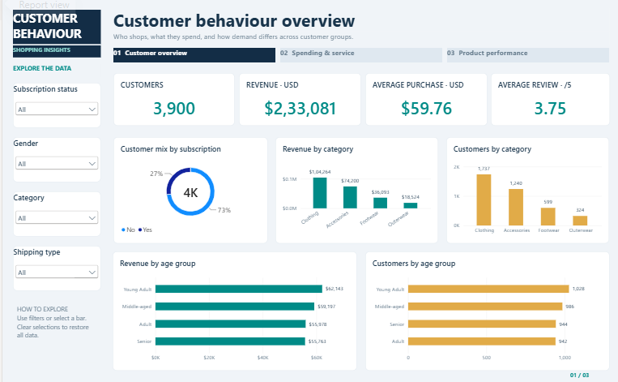
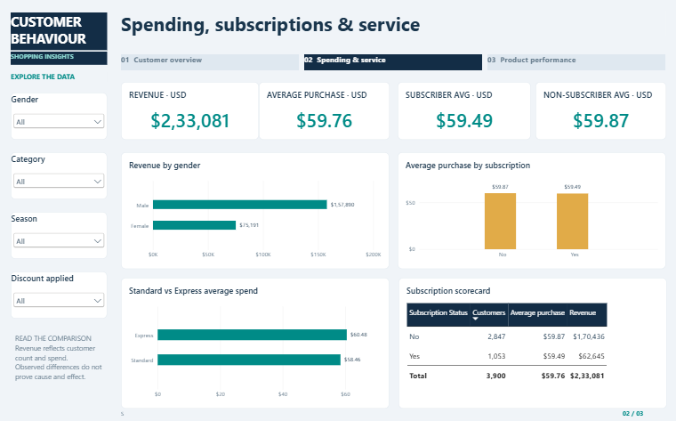
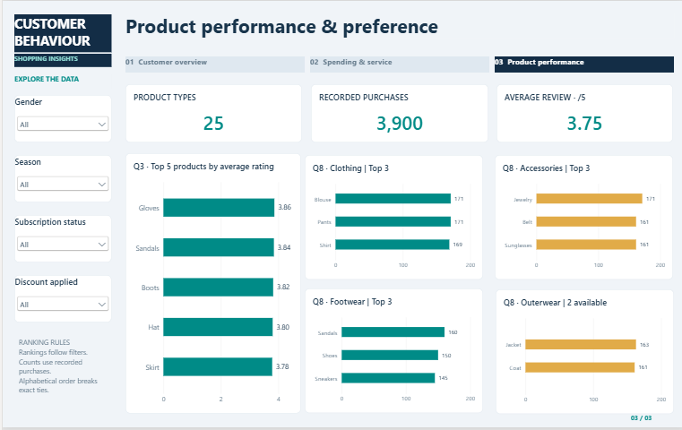

<h2 align="center">🛍️ ShopperScope — Customer Behavior & Retail Revenue Intelligence</h2>
 <strong>3,900 shoppers. $233,081 in purchases. Clear insights for smarter retail decisions.</strong>  An end-to-end Python + SQL Server + Power BI project exploring customer spending, products, subscriptions, and promotions. 

     

 <a href="#-key-business-insights">Insights</a> · <a href="#-power-bi-dashboard">Dashboard</a> · <a href="#-data-resources">Dataset</a> · <a href="#-workflow--tools">Workflow</a> 

📌 Project Snapshot
Turned 3,900 US retail shopping records into an interactive BI report to understand where purchase value comes from and which marketing, product, and service decisions are worth testing.

💰 Total purchase value	👥 Customers	🧾 Avg. purchase	⭐ Avg. rating
$233,081	3,900	$59.76	3.75 / 5
🔥 Key Business Insights
The numbers tell the story—and point to the next business decision.

What the data reveals	Why it matters for business growth
🛍️ Clothing: $104,264 (44.73%); Clothing + Accessories: $178,464 (76.56%)	Focus merchandising and test cross-category recommendations where most purchase value is recorded.
🏆 3,116 shoppers (79.90%) have more than 10 reported previous purchases, contributing $185,517	Test relevant offers for established shoppers and next-purchase journeys for newer shoppers.
🏷️ 1,677 purchases (43%) have a discount flag; discounted average $59.28 vs $60.13 without one	Measure whether promotions produce incremental profit before expanding discounts.
💳 1,053 subscribers (27%); average purchase $59.49 vs $59.87 for non-subscribers	Test membership benefits carefully: all subscribers are also discount-flagged, so subscription effects cannot be isolated here.
🍂 Fall: $60,018, highest recorded seasonal purchase value; Size M: 1,755 purchases (45%)	Explore seasonal assortment and size-level stock planning, then validate against inventory data.
⭐ Gloves: 3.86/5 average rating vs Shirts: 3.62/5	Investigate lower-rated products and use authentic feedback to improve the shopping experience.
🚚 Express: $60.48 average purchase vs Standard: $58.46	Test shipping incentives only when added margin covers delivery costs.
Best growth opportunities: Prioritize Clothing + Accessories, run margin-aware promotion tests, and improve subscriber value without automatically offering more discounts.

## 📊 Power BI Dashboard

### 01 · Customer Overview — Who shops and where does revenue come from?

*Revenue, customers, average purchase, ratings, demographics, category performance, and subscription mix.*

---

### 02 · Spending & Service — How do subscriptions and shipping compare?

*Subscriber vs. non-subscriber spending, gender-based purchases, delivery methods, and interactive filters.*

---

### 03 · Product Performance — Which products stand out?

*Top-rated products and category-level product comparisons across Clothing, Accessories, Footwear, and Outerwear.*

📂 Data Resources

  

The Google Drive dataset folder contains customer_shopping_behavior.xls (the supplied file uses CSV-formatted content). The Python notebook documents how the data is cleaned and prepared.

Ensure Google Drive access is set to Anyone with the link → Viewer for recruiters.

⚙️ Workflow & Tools
Raw data → Python cleaning → SQL Server analysis → Power BI dashboard → Business insights

Python / pandas: Filled 37 missing ratings using category medians, engineered age groups, standardized columns, and removed a duplicate promotion flag.
SQL Server: Answered 8 business questions using aggregation, CTEs, subqueries, and window functions.
Power BI: Built 3 interactive pages with KPIs, category comparisons, subscriber spending, shipping analysis, and product rankings.
To explore: Download the dataset from Drive, run the Python notebook with a local input path, load its output into SQL Server, then open the .pbix report in Power BI Desktop and update the data connection if needed.

Analytical note: This is a descriptive shopping dataset—not a churn or predictive modeling project. It does not provide dated transaction history, profit margins, or campaign costs. Recommendations are opportunities to test, not proven revenue or profit increases.

<strong>Built to turn data into clear, practical retail decisions. 📈</strong>

